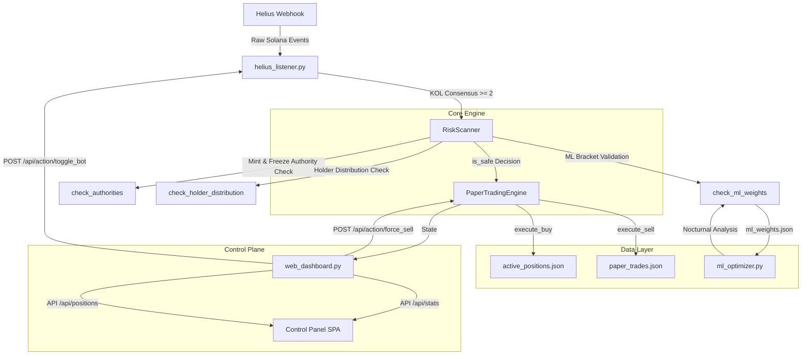

# Solana Autonomous Quant Fund

[](https://www.python.org/)
[](https://solana.com/)
[](https://scikit-learn.org/)
[](https://docs.aiohttp.org/)
[](https://vuejs.org/)
[](https://tailwindcss.com/)

---

## Executive Summary

Solana Autonomous Quant Fund is a fully autonomous paper-trading system built on the Solana blockchain. The platform captures real-time on-chain movements from Key Opinion Leaders (KOLs) via the Helius webhook infrastructure, applies a multi-layered on-chain risk filter to exclude honeypots and rug-pulls, executes simulated trades with millisecond precision against a strict 2.0 SOL capital mandate, and continuously refines its investment criteria through a nocturnal Machine Learning feedback loop.

The system is designed for quantitative research and strategy validation in a risk-free paper-trading environment before any live capital deployment.

## Architecture



## Features

### 1. Cerveau Analytique — On-Chain Risk Filter

The `RiskScanner` module implements a three-gate on-chain analysis pipeline:

- **Authority Revocation Check**: Verifies that both Mint Authority and Freeze Authority are set to `None` (revoked) on the token's mint account, eliminating the risk of the issuer freezing or minting additional supply post-deployment.
- **Holder Distribution Analysis**: Retrieves the top token holders via Solana RPC and excludes known Raydium and Pump.fun program addresses. Rejects tokens where the top 10 non-program holders control more than 25% of the total supply, mitigating concentration risk.
- **Machine Learning Weight Validation**: Reads `data/ml_weights.json` produced by the nocturnal optimizer. Determines the Market Cap bracket (Micro < $15k, Low $15k–$50k, Mid > $50k) and rejects the token if the bracket's historical winrate is strictly below 40% or its average PnL is negative, provided at least 5 trades have been analyzed.

### 2. Moteur d'Exécution Réaliste — Paper Trading Engine

The `PaperTradingEngine` enforces strict financial constraints to simulate real-world trading conditions:

- **Fixed Capital Mandate**: Initial balance locked at exactly 2.0 SOL.
- **Fixed Position Size**: Each trade consumes exactly 0.05 SOL.
- **Transaction Fees**: A flat 0.002 SOL fee (simulating Jito priority tip and base Solana network fees) is deducted on every buy and sell execution.
- **Dynamic Slippage**: A default 2.5% slippage is applied to the entry price (buying at a premium) and to the exit price (selling at a discount), reflecting realistic market impact.
- **Balance Guardrail**: The `execute_buy` method refuses any trade when `sol_balance < (0.05 + 0.002)`, preventing overdraft.
- **Persistent State**: All active positions are stored in `data/active_positions.json`; every executed trade is appended to `logs/paper_trades.json`.

### 3. Auto-apprentissage — ML Feedback Loop

The `MLOptimizer` (`tools/ml_optimizer.py`) performs nocturnal analysis of simulated trades to refine future investment decisions:

- **Session Reconstruction**: Pairs every BUY order with its corresponding SELL order(s) using the token mint address as the correlation key.
- **Performance Metrics**: Computes final PnL in SOL, win/loss status, and entry Market Cap for each completed trade session.
- **Market Cap Bracketing**: Segregates trades into three brackets:
  - **Micro**: Market Cap < $15,000
  - **Low**: Market Cap $15,000 – $50,000
  - **Mid**: Market Cap > $50,000
- **Weight Generation**: Calculates winrate and average PnL per bracket, identifies the most profitable bracket (highest winrate × average PnL), and exports `data/ml_weights.json` for consumption by the `RiskScanner`.

### 4. Terminal de Contrôle — Institutional Control Panel

The `web_dashboard.py` backend serves a single-page application (SPA) built with Vue.js 3 and Tailwind CSS, providing real-time visibility and manual override capabilities:

- **Live Telemetry**: Displays current SOL balance, total PnL, winrate percentage, completed trade count, and bot operational status.
- **ML Intelligence Panel**: Shows ML-driven statistics, the recommended Market Cap bracket, and an optional ML filter override toggle.
- **Active Positions Table**: Lists all open positions with entry price, token quantity, SOL invested, and per-position action buttons for partial (50%) or full (100%) forced sells.
- **Trade History**: Scrollable feed of the last 20 executed trades with action type, ticker, SOL amount, and timestamp.
- **Emergency Stop**: A prominent kill-switch button that pauses the Helius listener immediately, halting all new trade discovery and execution.


## Project Structure

```
/home/kilpi/trading_bot/
├── main.py                          # Pipeline entry point (6-agent sequential chain)
├── config.py                        # Environment variable loader
├── setup_helius_webhook.py          # Helius webhook registration utility
│
├── core/
│   ├── __init__.py
│   ├── paper_engine.py              # PaperTradingEngine: balance, slippage, fees, position persistence
│   ├── risk_scanner.py              # RiskScanner: anti-rug filter + ML bracket validation
│   ├── state.py                     # TokenState dataclass for the pipeline
│   ├── llm.py                       # LLM integration utilities
│   └── power.py                     # Power management utilities
│
├── agents/
│   ├── bot1_scout.py                # Token discovery agent
│   ├── bot2_news.py                 # News sentiment agent
│   ├── bot3_sentiment.py            # Social sentiment agent
│   ├── bot4_charts.py               # Technical chart analysis agent
│   ├── bot5_risk.py                 # Risk assessment agent
│   ├── bot6_decision.py             # Trade decision agent
│   ├── helius_listener.py           # Helius webhook listener (port 5000)
│   ├── position_manager.py          # Position lifecycle manager
│   ├── telegram_listener.py         # Telegram command listener
│   ├── kol_tracker.py               # KOL wallet tracker
│   └── Helius.py                    # Helius API client
│
├── tools/
│   ├── ml_optimizer.py              # Nocturnal ML feedback loop optimizer
│   ├── web_dashboard.py             # Control Panel API (port 8080)
│   └── static/
│       └── index.html               # Vue.js 3 SPA frontend
│
├── data/
│   ├── active_positions.json        # Live position state
│   ├── ml_weights.json              # ML bracket weights (optimizer output)
│   ├── smart_wallets.json           # Tracked KOL wallet addresses
│   └── audit_narratives.json        # Trade discovery audit log
│
└── logs/
    ├── paper_trades.json            # Complete trade execution history
    ├── helius_listener.log          # Listener runtime logs
    └── web_dashboard.log            # Dashboard runtime logs
```

## Installation

### Prerequisites

- Python 3.12 or higher
- `pip` package manager
- A Solana RPC endpoint (Helius, QuickNode, or public mainnet-beta)
- A Helius webhook URL for real-time transaction streaming

### Step 1 — Clone the Repository

```bash
git clone https://github.com/mlelanno/sol-bot.git
cd sol-bot
```

### Step 2 — Create a Virtual Environment

```bash
python3 -m venv venv
source venv/bin/activate
```

### Step 3 — Install Dependencies

```bash
pip install aiohttp requests
```

### Step 4 — Configure Environment Variables

Create a `.env` file in the project root:

```ini
TELEGRAM_BOT_TOKEN=your_telegram_bot_token
TELEGRAM_CHANNEL_ID=your_telegram_channel_id
```

### Step 5 — Register the Helius Webhook

```bash
python3 setup_helius_webhook.py
```

Ensure the webhook points to `https://<your-host>:5000/webhook`.

## Launch Instructions

### Option A — Manual Launch

Start the Helius listener (event ingestion, port 5000):

```bash
cd /home/kilpi/trading_bot
PYTHONPATH=/home/kilpi/trading_bot nohup python3 -u agents/helius_listener.py > logs/helius_listener.log 2>&1 &
```

Start the Control Panel API (frontend, port 8080):

```bash
cd /home/kilpi/trading_bot
PYTHONPATH=/home/kilpi/trading_bot nohup python3 -u tools/web_dashboard.py > logs/web_dashboard.log 2>&1 &
```

Access the Control Panel at `http://<your-host>:8080`.

### Option B — Cronjob Automation

To ensure the listener restarts automatically after system reboots or crashes, add the following to the system crontab (`sudo crontab -e`):

```cron
@reboot cd /home/kilpi/trading_bot && PYTHONPATH=/home/kilpi/trading_bot nohup python3 -u agents/helius_listener.py >> logs/helius_listener.log 2>&1 &
@reboot cd /home/kilpi/trading_bot && PYTHONPATH=/home/kilpi/trading_bot nohup python3 -u tools/web_dashboard.py >> logs/web_dashboard.log 2>&1 &
```

Optionally, schedule the ML optimizer to run nightly (e.g., 03:00 UTC):

```cron
0 3 * * * cd /home/kilpi/trading_bot && PYTHONPATH=/home/kilpi/trading_bot python3 -u tools/ml_optimizer.py >> logs/ml_optimizer.log 2>&1
```

### Ports Summary

| Service | Port | Endpoint |
|---------|------|----------|
| Helius Listener | 5000 | `POST /webhook` |
| Control Panel API | 8080 | `GET /`, `GET /api/stats`, `GET /api/positions`, `POST /api/action/force_sell`, `POST /api/action/toggle_bot` |

## Risk Disclaimer

This system operates exclusively in a **paper-trading (simulated)** environment. No real funds are at risk. All prices, balances, and PnL figures are simulated and do not reflect actual market execution. The ML feedback loop is trained exclusively on historical simulated trade data and does not guarantee future performance. This software is intended for quantitative research and strategy development purposes only.

